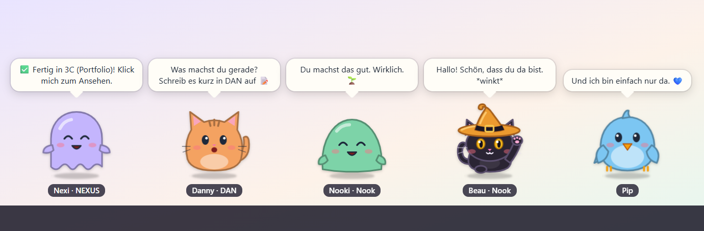
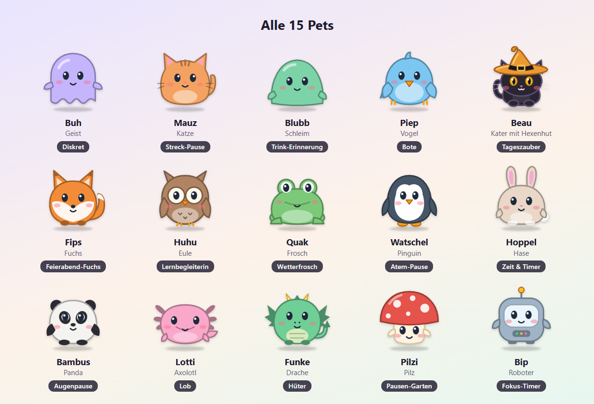

<p align="center">
  
</p>

<h1 align="center">Desktop Companions</h1>

<p align="center"><strong>Kleine Begleiter für deinen Bildschirm – sie erinnern, gratulieren und plaudern miteinander.</strong><br>
<em>Immer da. Nie im Weg.</em></p>

<p align="center">
  <a href="https://github.com/CaseyMazey/Desktop-Companions/releases/latest/download/Desktop-Companions-Setup.exe"></a>
  <a href="#macos"></a>
  <a href="#linux"></a>
</p>

<p align="center">
  <a href="https://github.com/CaseyMazey/Desktop-Companions/releases/latest"></a>
  
  
  
</p>

<p align="center">
  
</p>

Du vergisst beim Arbeiten, deinen Ausbildungsnachweis zu schreiben, Wasser zu trinken oder nachzusehen, ob Claude schon fertig ist? **Kleine Pets sitzen unten auf deinem Bildschirm und sagen dir Bescheid.**

- 🐾 **Immer im Vordergrund, nie im Weg.** Klicks neben dem Pet gehen durch, ziehen kannst du es überallhin – auch auf einen zweiten Monitor.
- 🦊 **15 Tiere mit eigenem Charakter.** Jedes klingt anders und hat ein hilfreiches Talent: Fokus-Timer, Feierabend, Trinken, Augenpause, Wetter … ([alle Pets](#die-pets))
- ✳️ **Sagt Bescheid, wenn Claude fertig ist.** Ideal mit mehreren Monitoren: Setz ein Pet in die Ecke, und du verpasst nichts mehr.
- 🔗 **Verbunden mit deiner App.** Ein Klick aufs Pet öffnet NEXUS, DAN, Nook, Claude, Gmail, Spotify oder jede andere App.
- 💬 **Mehrere Pets, die miteinander reden.** Stehen sie nebeneinander, plaudern sie ab und zu – und jedes Tier bleibt dabei es selbst.
- 💛 **Streicheln erlaubt.** Fahr mit der Maus über ein Pet hin und her – es freut sich. Die Augen folgen deinem Mauszeiger.
- 🔒 **Ohne Konto, ohne Server.** Desktop Companions läuft komplett auf deinem Rechner.

## Installieren

Desktop Companions gibt es kostenlos für Windows, macOS und Linux, direkt hier von GitHub.

### Windows

1. **[Desktop-Companions-Setup.exe herunterladen](https://github.com/CaseyMazey/Desktop-Companions/releases/latest/download/Desktop-Companions-Setup.exe)** (Windows 10/11).
2. Die Datei ausführen. Desktop Companions installiert sich für deinen Benutzer, ohne Admin-Rechte, mit Verknüpfung auf dem Desktop und im Startmenü, und startet gleich.
3. Erscheint „Der Computer wurde durch Windows geschützt“: auf **Weitere Informationen → Trotzdem ausführen** klicken. Die Meldung kommt, weil das Setup nicht signiert ist.

**Updates kommen automatisch** (ab Version 0.4.0): Desktop Companions lädt neue Versionen im Hintergrund und fragt, ob es gleich neu starten soll, sonst wird beim Beenden installiert. Von Hand: Tray → *Nach Updates suchen*. Deine Pets bleiben erhalten. Wer noch die alte App „Pets“ oder eine Version vor 0.4.0 hat, installiert einmal von Hand neu; der Installer ersetzt die alte App, und deine Pets ziehen mit um.

### macOS

1. Herunterladen, passend zu deinem Mac (Apfel-Menü → Über diesen Mac):
   - **[Apple Silicon (M1, M2, M3 …)](https://github.com/CaseyMazey/Desktop-Companions/releases/latest/download/Desktop-Companions-mac-arm64.dmg)**
   - **[Intel](https://github.com/CaseyMazey/Desktop-Companions/releases/latest/download/Desktop-Companions-mac-x64.dmg)**
2. Die `.dmg` öffnen und **Desktop Companions in den Ordner „Programme“ ziehen**.
3. **Beim ersten Öffnen** blockiert macOS die App, weil sie nicht über ein kostenpflichtiges Apple-Entwicklerkonto signiert ist:
   - **Rechtsklick** auf Desktop Companions → **Öffnen** → **Öffnen**.
   - Klappt das nicht (macOS 15 und neuer): **Systemeinstellungen → Datenschutz & Sicherheit**, nach unten scrollen, bei Desktop Companions auf **„Dennoch öffnen“** klicken.
   - Meldet macOS, die App sei **„beschädigt“**: Terminal öffnen und `xattr -dr com.apple.quarantine "/Applications/Desktop Companions.app"` eingeben.

Desktop Companions erscheint unter macOS nicht im Dock, sondern als Symbol in der Menüleiste.

### Linux

- **Debian, Ubuntu, Mint …:** **[Desktop-Companions-linux-amd64.deb](https://github.com/CaseyMazey/Desktop-Companions/releases/latest/download/Desktop-Companions-linux-amd64.deb)** herunterladen und installieren:
  ```bash
  sudo apt install ./Desktop-Companions-linux-amd64.deb
  ```
- **Alle anderen (Fedora, Arch …):** **[Desktop-Companions-linux-x86_64.AppImage](https://github.com/CaseyMazey/Desktop-Companions/releases/latest/download/Desktop-Companions-linux-x86_64.AppImage)** herunterladen, ausführbar machen und starten:
  ```bash
  chmod +x Desktop-Companions-linux-x86_64.AppImage && ./Desktop-Companions-linux-x86_64.AppImage
  ```

Unter Linux gehen Klicks direkt neben dem Pet nicht zum Fenster dahinter durch (das unterstützt Linux für durchsichtige Fenster nicht).

## So benutzt du Desktop Companions

| Aktion | Was passiert |
|---|---|
| **Klick aufs Pet** | öffnet die verbundene App |
| **Klick auf die Sprechblase** | öffnet die App (z. B. DAN, um gleich aufzuschreiben) |
| **Ziehen** | verschiebt das Pet; auf einem anderen abgesetzt, rutscht es zur Seite |
| **Maus hin und her (ohne Klick)** | streichelt das Pet: Augen zu, Herzchen, ein Spruch |
| **Rechtsklick** | Menü: Talent (z. B. Fokus starten, Timer, Atem-Pause), Sag was, Ausblenden, Schlafen legen, Frei herumwandern, Einstellungen, Entfernen |
| **Auge in den Einstellungen** | blendet ein Pet auf dem Desktop aus und wieder ein – ohne es zu entfernen |
| **Tray-Symbol** | neues Pet, Einstellungen, Pets verstecken, Beenden |

Beim ersten Start legt Desktop Companions für jede gefundene App (NEXUS, DAN, Nook) ein eigenes Pet an. Pets bleiben standardmäßig an ihrem Platz und tapsen dort nur ein bisschen herum; „Frei herumwandern“ lässt sie über die ganze Bildschirmkante laufen.

## Die Pets

<p align="center">
  
</p>

Jedes Tier hat einen eigenen Charakter und ein Talent. Talente melden sich nur ein paar Mal am Tag, nie, wenn du weg bist, und lassen sich pro Pet in den Einstellungen ausschalten oder anpassen.

| Pet | Charakter | Talent |
|---|---|---|
| **Buh** 👻 | schüchtern, entschuldigt sich ständig | **Diskret:** wird durchsichtig, wenn die Maus kommt; im Meeting (Mikrofon oder Kamera an) oder bei Vollbild versteckt Buh **alle** Pets (Windows) |
| **Mauz** 🐱 | Diva, heimlich fürsorglich | **Streck-Pause:** nach etwa 90 Minuten am Stück streckt sie sich – du machst mit |
| **Blubb** 🟢 | überschwänglicher Optimist | **Trink-Erinnerung:** etwa alle 75 Minuten |
| **Piep** 🐦 | neugierige Plaudertasche | **Bote:** erzählt dir, was passiert ist, während du weg warst |
| **Beau** 🎩 | mystisch, würdevoll, herzlich | **Tageszauber:** einmal am Tag eine Karte aus dem Hut |
| **Fips** 🦊 | schlau und verschmitzt | **Feierabend-Fuchs:** 30 Minuten vorher „Was willst du noch schaffen?“, dann „Feierabend!“ (Uhrzeit einstellbar) |
| **Huhu** 🦉 | weise Professorin | **Lernbegleiterin:** Lernpausen, abends „Was hast du gelernt?“, nachts große Augen |
| **Quak** 🐸 | laut, gut gelaunt, liebt Kalauer | **Wetterfrosch:** morgens das Wetter mit Tipp – nur wenn du einen Ort einträgst |
| **Watschel** 🐧 | tiefenentspannt | **Atem-Pause:** Rechtsklick → eine Minute gemeinsam atmen |
| **Hoppel** 🐰 | nervös, immer in Eile | **Zeit & Timer:** Rechtsklick → „Erinnere mich in …“, auf Wunsch die volle Stunde |
| **Bambus** 🐼 | gemütlicher Genießer | **Augenpause 20-20-20:** alle 20 Minuten kurz in die Ferne schauen |
| **Lotti** 🩷 | dein größter Fan | **Lob:** feiert jeden fertigen Auftrag und zählt abends zusammen |
| **Funke** 🐉 | stolzer Beschützer | **Hüter:** warnt bei schwachem Akku, erinnert wöchentlich an die Datensicherung |
| **Pilzi** 🍄 | still und philosophisch | **Pausen-Garten:** jede Pause lässt neben ihm etwas wachsen |
| **Bip** 🤖 | logisch, lernt Gefühle | **Fokus-Timer:** Rechtsklick → 25 Minuten Fokus, 5 Pause, mit Countdown |

## Voreinstellungen

| Verbunden mit | Was das Pet macht |
|---|---|
| **NEXUS** | meldet, wenn ein Auftrag in 3C fertig ist, schiefging oder Claude eine Entscheidung braucht |
| **DAN** | erinnert Mo–Fr stündlich (7:30–16:30) daran aufzuschreiben, was du gerade machst; um 15:45 die Feierabend-Erinnerung |
| **Nook** | sagt alle 45 Minuten etwas Nettes oder erinnert an Pausen und Wasser; um 12:30 Mittagspause |
| **3C** | wie NEXUS, aber nur die Meldungen aus 3C: fertig, schiefgegangen, Entscheidung nötig |
| **Claude · Claude Code** | sagt Bescheid, wenn Claude fertig ist oder deine Entscheidung braucht – mit Projektname ([einmal einrichten](#claude-meldungen-einrichten)) |
| **ChatGPT** | öffnet ChatGPT |
| **Gmail · Outlook** | öffnet die Mails und erinnert werktags ab und zu daran |
| **Google Kalender · Teams** | Kalender: fragt werktags um 8:45, was heute ansteht · Teams: öffnet Teams |
| **Spotify · Notion · Obsidian** | öffnet die App (sonst die Webseite) |
| **Eigene App** | öffnet ein beliebiges Programm, eine Datei oder eine `https://`-Adresse |

**Neues Pet anlegen:** *+ Neues Pet* (Einstellungen oder Tray) → erst das **Tier** wählen, dann die **Verbindung**. Beau 🎩 ist ein eigenes Tier: mit Nook bekommt er seine eigenen Sprüche und begrüßt dich beim Start.

Alles lässt sich pro Pet in den Einstellungen ändern: Tier, Farbe, Größe, Talent, Sprüche, Abstand, Uhrzeiten und ob es herumläuft.

### Claude-Meldungen einrichten

Damit ein Pet Bescheid sagt, wenn Claude (Code) fertig ist oder dich braucht, muss Claude Code den Pets eine Nachricht schicken:

1. Pet mit **Claude** oder **Claude Code** verbinden (z. B. *+ Neues Pet* → Tier → Claude Code).
2. In den Einstellungen des Pets unter *Verbindung* auf **„In Claude Code eintragen“** klicken. Das trägt einen kleinen Hook in `~/.claude/settings.json` ein (vorher wird eine Sicherung `settings.json.bak` angelegt, andere Einstellungen bleiben unverändert).
3. Claude neu starten. Gilt für Claude Code im Terminal und in der Claude-App.

Tipp für mehrere Monitore: Windows zeigt seine Benachrichtigungen nur auf dem Hauptbildschirm – setz das Pet einfach in die Ecke des Monitors, auf den du schaust.

## Für Entwickler

```bash
npm install
npm start
```

- `npm test` prüft die Logik (Erinnerungen, Platz, Nachbarn, Gespräche, Talente, Streicheln, Presets, Claude-Hook, Schnittstelle).
- `npm run smoke` startet die App mit Test-Pets in einem eigenen Datenordner, fotografiert sie und beendet sich.
- `npx electron scripts/screenshot.js` erzeugt die Bilder im README neu (`docs/screenshots/pets.png` und `all-pets.png`).
- **Neue Version:** Version in `package.json` erhöhen, committen, dann `git tag v<version> && git push --tags`. GitHub baut die Installer für alle drei Systeme und legt das Release an.

### Schnittstelle für andere Apps

Desktop Companions lauscht auf `http://127.0.0.1:47811` (nur dieser Rechner). Jede App kann ihrem Pet etwas sagen lassen:

```
POST /event
Content-Type: application/json

{ "app": "dan", "type": "say", "text": "Wochenbericht ist fertig!" }
```

`type`: `say` (mit `text`), `task-done`, `task-error`, `decision` (optional `project`).
Es reagieren alle Pets, die mit dieser App verbunden sind (oder mit `"pet": "<id>"` genau eins).
NEXUS schickt fertige 3C-Aufträge und Rückfragen von selbst.

Für Claude Code gibt es zusätzlich `POST /hook/claude-code`: Der Hook reicht die Daten von Claude Code (`Stop`, `Notification`) unverändert weiter, Desktop Companions macht daraus „fertig“ bzw. „braucht dich“ mit Projektname.
